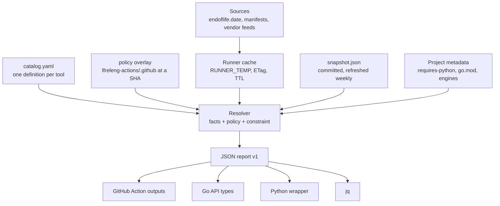

<!--
SPDX-License-Identifier: Apache-2.0
SPDX-FileCopyrightText: 2026 The Linux Foundation
-->

# supported-versions-action: design and development plan

<!-- markdownlint-disable MD013 -->

| Field    | Value                                                                                            |
| -------- | ------------------------------------------------------------------------------------------------ |
| Status   | Accepted: Phase 0 decisions recorded 2026-10-28 (section 13)                                     |
| Date     | 2026-10-26; updated 2026-10-28                                                                   |
| Authors  | Matthew Watkins, with Claude (Zed agent)                                                         |
| Replaces | `lfreleng-actions/python-supported-versions-action`                                              |
| Changes  | `build-metadata-action`, `java-workflows`, `node-workflows`, Python lanes                        |
| Tracking | `lfreleng-actions/python-supported-versions-action#196`; phase items in this repository's issues |

<!-- markdownlint-enable MD013 -->

## 1. Summary

Build one Go module that answers two questions for any tool the
`lfreleng-actions` estate builds with:

1. **Is tool X at version Y still supported, or end-of-life (EOL)?**
2. **Which versions of tool X should a matrix job run against today?**

The module reads a single data file, `catalog.yaml`, that defines every
tool once: where its release facts come from, how a version maps to a
release line, and the organisation's policy for admitting lines into a
matrix. The module fetches release facts live (endoflife.date first,
vendor feeds where they are authoritative), caches them on the runner
so one job never fetches the same data twice, and backs them with a
committed snapshot for isolated runners. Code contains no version
numbers at all.

One implementation serves four kinds of consumer:

| Consumer         | Interface                                               |
| ---------------- | ------------------------------------------------------- |
| GitHub workflows | `lfreleng-actions/supported-versions-action`            |
| Go tools         | Import the module (`build-metadata-action` first)       |
| Python tools     | A PyPI wheel that bundles the same binary (`uvx`-able)  |
| Shell, anything  | The CLI's versioned JSON output, read with `jq`         |

The first release covers Python, Go, Node.js, Java (JDK), Maven, Gradle
and Rust: the toolchains of the organisation's nine workflow lanes. The
catalog grows without code changes for any tool endoflife.date lists
(486 products today).

## 2. The problem

### 2.1 What happened this week

Python 3.10 reached EOL on 2026-10-01. On 2026-10-26 the `Python Audit
(3.10)` job on `http-api-tool-docker`'s `main` failed: `pip-audit`
installs `filelock` into the interpreter it audits, every `filelock`
release from 4.1.1 on requires Python 3.11, so Python 3.10 could
receive nothing newer than the vulnerable 4.1.0 (CVE-2026-112906). An
EOL interpreter that nothing had flagged blocked a security fix.

Fixing it meant raising the project's floor to 3.11
(`http-api-tool-docker#446`). Two further findings came out of that:

- `build-metadata-action`, which derives every Python matrix in the
  organisation, caps the range at 3.14 in a Go constant
  (`internal/pyversions/eol.go`, `latestMinor = 14`). Python 3.15
  shipped on 2026-10-09 and `actions/setup-python` has installed it
  since; 17 days later no derived matrix includes it. Adding it needs a
  release of `build-metadata-action`, then `python-build-action`, then
  `python-workflows`, then a bump in every calling repository.
- `python-supported-versions-action` wrote its range out in four places
  (two static lists, two regexes) with no upper bound: it would have
  admitted 3.16, or 4.0, the day endoflife.date listed it.
  `python-supported-versions-action#194` reduces that to one
  oldest/newest pair, but it remains a bash-and-jq implementation that
  disagrees with the Go one (3.11 to 3.15 against 3.10 to 3.14).

### 2.2 The estate today

146 active repositories: 100 composite actions, 9 reusable-workflow
lanes (`python`, `go`, `node`, `java`, `rust`, `docker`, `security`,
`docs`, `generic`) and 37 tools, bots and `test-*-project` fixtures.
By primary language: Python 48, Shell 27, JavaScript and TypeScript 8,
Go 2, Rust 1.

The estate chooses versions in four unrelated ways:

<!-- markdownlint-disable MD013 -->

| Mechanism                            | Where                                                                                                                                                                        | State                                                                                                                                                                                  |
| ------------------------------------ | ---------------------------------------------------------------------------------------------------------------------------------------------------------------------------- | -------------------------------------------------------------------------------------------------------------------------------------------------------------------------------------- |
| endoflife.date plus Go constants     | `build-metadata-action`: Python (3.10 to 3.14), Go (1.26 to 1.27); Rust from its release train                                                                               | The Python and Go modules are near-copies (665 lines); the Python floor is still 3.10, four weeks after EOL; the ceiling blocks 3.15                                                   |
| Fixed lists in Go code               | `build-metadata-action`: .NET, Terraform, Ruby, PHP, Dart, Elixir, Haskell, Julia, Scala, Swift, Helm                                                                        | Stale. .NET defaults to 8.0/7.0/6.0 (6 and 7 are EOL; 9 and 10 missing). Terraform lists 1.8 to 1.10 (1.15 and 1.16 are current). Helm's list is Kubernetes 1.27 to 1.30               |
| Bash and jq against endoflife.date   | `python-supported-versions-action`: 919-line `action.yaml`, 687 lines of library, 583 lines of tests, 14 fixtures                                                            | Range duplicated four times until #194; a Bash 3.2 portability bug surfaced in that review                                                                                             |
| Hand-written tables in workflow YAML | `java-workflows/java-maven-versions.yaml`: Java `["17","21","22","23","24","25"]`, Maven lines with SHA-512, Gradle lines with `max_java`; `node-workflows`: default Node 22 | Maintained by hand and invisible to the other mechanisms. Temurin 22, 23 and 24 are EOL (non-LTS lines end six months after release), so three of the six Java legs test dead versions |

<!-- markdownlint-enable MD013 -->

Consumers of the two existing actions:

<!-- markdownlint-disable MD013 -->

| Action                             | Consumers                                                                                                                                                                           |
| ---------------------------------- | ----------------------------------------------------------------------------------------------------------------------------------------------------------------------------------- |
| `build-metadata-action`            | `python-build-action`; `python-workflows` (2 workflows); `go-workflows`; `rust-workflows`; `node-workflows` (3); `java-workflows` (3); `docker-workflows`; `security-workflows` (2) |
| `python-supported-versions-action` | `python-project-metadata-action` (`build_python`, `matrix_json`) and `rtd-config-audit-action` (`supported_versions`), both pinned at v0.2.3, two releases behind                   |

<!-- markdownlint-enable MD013 -->

At least a dozen repositories also pin `python-version:` literals in
their own test workflows (17 repositories use `actions/setup-python`
directly). Those are a linting target once the module exists (section
12, phase 5).

### 2.3 Patterns the organisation already has

The design reuses these rather than inventing new ones:

- **Go actions built at run time.** `build-metadata-action`,
  `version-extract-action`, `go-build-action`, `rust-build-action`,
  `sbom-action` and `go-httpbin-action` all run `go build` in a
  composite step after `actions/setup-go`.
- **Attested binary downloads.** `zizmor-scan-action` downloads a
  release binary and runs `gh attestation verify` before trusting it.
- **Pinned remote configuration.** `python-audit-action` and
  `harden-runner-block-action` accept a `config` input in GitHub
  `uses:` coordinate form (`owner/repo//path@sha`), resolved against
  `lfreleng-actions/.github/.github/<family>/<org>/<file>`.
- **Binaries inside Python wheels.** `shellcheck-py` and `hadolint-py`,
  both used by the organisation's pre-commit configurations, ship a
  foreign binary in platform wheels.
- **The egress allow-list** already permits every host this design
  needs (appendix B).

## 3. Goals and non-goals

### Goals

1. One definition per tool, in data, outside source code.
2. Live data by default, cached per job, with an offline fallback that
   states its age.
3. The same answer from every consumer: workflow, Go import, Python
   import, shell.
4. Policy that the organisation controls in one reviewed place, and
   that a project can narrow through its own metadata. New releases
   need no change anywhere: live data and `installable` admission bring
   them in.
5. Advance warning: the module reports a version within 90 days of EOL
   before it fails anything.
6. Extensible to new tools by editing the catalog, and to new source
   types by adding one small client.

### Non-goals

- Installing tools. `actions/setup-*` and the build actions do that.
- Deciding a project's own constraints. `requires-python`, `go.mod`,
  `engines.node` and friends remain the project's statement; the module
  reads them.
- Vulnerability data. `python-audit-action` and the security lane own
  that.
- Replacing `build-metadata-action`'s project-metadata extractors. It
  keeps them and imports this module for the version questions.
- Container base-image policy (`python:3.11-slim` and similar). A later
  catalog extension, not part of the first release.

## 4. Findings from this thread, and the requirements they set

<!-- markdownlint-disable MD013 -->

| #   | Finding                                                                                                                    | Design response                                                                                                                                                                          |
| --- | -------------------------------------------------------------------------------------------------------------------------- | ---------------------------------------------------------------------------------------------------------------------------------------------------------------------------------------- |
| 1   | The Python range lived in four places in one action, and two actions disagreed (3.10 to 3.14 against 3.11 with no ceiling) | One catalog. A CI check rejects any version literal in non-test Go source (`_test.go` files and `testdata/` are exempt)                                                                  |
| 2   | Python 3.15 is still absent 17 days after release because four releases must chain                                         | Live data and `installable` admission bring new releases in with no release chain; organisation policy lives in one overlay fetched at a pinned SHA (section 6.8)                        |
| 3   | An EOL interpreter blocked a security fix; nothing warned beforehand                                                       | `status` derived from dates, `days_to_eol`, a 90-day warning, and `eol_behaviour: fail` for lanes that want a hard stop                                                                  |
| 4   | endoflife.date marks Node 16, 18 and 20 `isMaintained: true` (commercial support) although they are past EOL               | Status comes from `eolFrom`/`isEol`, never from `isMaintained`                                                                                                                           |
| 5   | endoflife.date listed 3.15 one day after release; `http-api-tool-docker`'s locked `pycurl` 7.45.7 ships no `cp315` wheels  | Admission gate: a line enters a matrix when a stable build exists in the relevant `actions/*-versions` manifest, plus an optional grace period; projects narrow further through metadata |
| 6   | A Bash 3.2 array-expansion bug (empty array under `set -u`) passed the bash test suite; review alone caught it             | A single Go implementation; CI on Ubuntu, macOS and Windows runners                                                                                                                      |
| 7   | Code Monkey's publisher refused the #193 change because `tests/scripts/test_all.sh` is executable                          | Repository convention: no executable files; scripts run through `bash` or `go run`; recorded in `AGENTS.md`                                                                              |
| 8   | A required check failed because of a blocked tool download, and the job then hung for 20 minutes                           | Documented endpoint list; snapshot fallback with an explicit `::warning::`; bounded timeouts; a block-mode CI job proves the list suffices                                               |
| 9   | A bot publish job lost network access mid-run                                                                              | Retries with backoff on transport errors; idempotent, atomic cache writes                                                                                                                |
| 10  | Code Monkey cannot work across repositories                                                                                | Every work item in section 12 stays within one repository                                                                                                                                |
| 11  | The `config` coordinate pattern already resolves organisation files at a SHA                                               | Reuse its grammar for the policy overlay instead of a new mechanism                                                                                                                      |
| 12  | Both consumers of `python-supported-versions-action` pin a two-release-old version                                         | A compatibility release keeps old pins working while they migrate                                                                                                                        |
| 13  | `java-workflows` tests on Temurin 22, 23 and 24, all EOL                                                                   | Java policy: LTS lines and nothing else, floor 17 (decision 5)                                                                                                                           |
| 14  | `filelock`'s own advisories (CVE-2026-112906, -112940) concern lock files and symlinks in shared directories               | The cache uses atomic rename, not lock files, in a private directory, and never follows symlinks                                                                                         |

<!-- markdownlint-enable MD013 -->

## 5. Scope: tools, sources and status

### 5.1 First-release tools

<!-- markdownlint-disable MD013 -->

| Tool    | Release line  | Primary source                   | Secondary source (installability or detail)            | Matrix rule         | Today's answer                          |
| ------- | ------------- | -------------------------------- | ------------------------------------------------------ | ------------------- | --------------------------------------- |
| Python  | `major.minor` | endoflife.date `python`          | `actions/python-versions` manifest                     | all, floor 3.11     | 3.11 3.12 3.13 3.14 3.15                |
| Go      | `major.minor` | endoflife.date `go`              | `actions/go-versions` manifest                         | all                 | 1.26 1.27                               |
| Node.js | `major`       | endoflife.date `nodejs`          | `actions/node-versions` manifest                       | lts                 | 22 24 26 (26 is LTS from 2026-10-28)    |
| Java    | `major`       | endoflife.date `eclipse-temurin` | Adoptium `available_releases`                          | lts, floor 17       | 17 21 25                                |
| Maven   | `major.minor` | endoflife.date `apache-maven`    | Maven Central `maven-metadata.xml` (latest patch, RCs) | all, no prerelease  | 3.9 3.10 (4.0 RC excluded unless asked) |
| Gradle  | `major`       | endoflife.date `gradle`          | `services.gradle.org/versions/all` (checksums)         | all                 | 8 9                                     |
| Rust    | `major.minor` | endoflife.date `rust`            | `static.rust-lang.org` stable channel manifest         | latest 6 + `stable` | 1.94 to 1.99, stable                    |

<!-- markdownlint-enable MD013 -->

Later catalog entries, each nothing more than a data change: Terraform
and OpenTofu, Ansible Core, Kubernetes, Docker Engine, .NET, Ruby, PHP,
Ubuntu and Debian (base images). Tools not on endoflife.date (`uv`, Helm, Dart,
Swift) need either a `github-releases` source or a `static` source
(section 6.6).

### 5.2 Version schemes

A **version** is what a user or a lock file names (`3.10.22`,
`21.0.5+11`, `v1.27.3`, `go1.27.3`, `py310`, `stable`). A **release
line** (endoflife.date's "cycle") is what support covers (`3.10`,
`21`, `1.27`). Each tool's `version_scheme` maps one to the
other, and normalises the common prefixes (`v`, `go`, `py`, `node`,
`temurin-`).

### 5.3 Status model

The module computes status from dates in the release facts and today's
date, never from a vendor's "maintained" flag (finding 4).

<!-- markdownlint-disable MD013 -->

| Status       | Meaning                                              | Derived from                                                  |
| ------------ | ---------------------------------------------------- | ------------------------------------------------------------- |
| `active`     | In active (bug-fix) support                          | released, `eoasFrom` not passed, `eolFrom` not passed         |
| `security`   | Security-fix or maintenance phase                    | `eoasFrom` passed, `eolFrom` not passed                       |
| `eol`        | Past end of life                                     | `eolFrom` passed, or `isEol` true                             |
| `extended`   | Past EOL, under paid extended support                | `eol`, and `eoesFrom` not passed; treated as `eol` by policy  |
| `prerelease` | Announced or RC, not generally available             | `releaseDate` in the future, or the vendor marks it RC        |
| `unknown`    | Not present in any source                            |                                                               |

<!-- markdownlint-enable MD013 -->

`supported` is a single boolean: status is `active` or `security`
**and** the line passes the policy (floor, ceiling, rule). A line that
upstream supports but policy excludes (Java 8 and 11 below the floor of
17) reports `supported: false, policy_excluded: true` so the two cases
stay distinguishable. Rust is the deliberate exception: upstream
supports nothing but the newest line, so its matrix rule admits EOL
lines on purpose and marks them.

## 6. Architecture

### 6.1 Components



### 6.2 Repository layout

Repository `lfreleng-actions/supported-versions-action`, created from
`actions-template`. Go module path
`github.com/lfreleng-actions/supported-versions-action`, matching
`build-metadata-action`'s convention of module path equals repository.

```text
action.yaml                 composite action (section 7.3)
catalog/
  catalog.yaml              the single tool definition file
  snapshot.json             machine-refreshed release facts (offline fallback)
  embed.go                  package catalogdata: go:embed for the files here
  schema/
    catalog.schema.json     validates catalog.yaml and policy overlays
    report.schema.json      the JSON output contract
cmd/supported-versions/     CLI
pkg/
  catalog/                  load, schema-check, merge overlay, embed
  source/                   one client per source type
    endoflife/  actionsmanifest/  adoptium/  gradle/  mavenmeta/
    rustchannel/  githubreleases/  static/
  cache/                    runner cache, ETag revalidation, atomic writes
  policy/                   rules, floor and ceiling, admission, EOL behaviour
  constraint/               pep440, semver ranges, go directive, java, maven
  detect/                   project-file detectors (pyproject, go.mod,
                            package.json, Cargo.toml, wrapper properties)
  versions/                 facade: Resolver, Report, Check; what importers use
internal/ghaction/          GITHUB_OUTPUT and step-summary writers
python/                     PyPI wrapper package (phase 6)
testdata/                   recorded upstream responses; parity fixtures
docs/                       catalog authoring guide, endpoints, integration notes
```

### 6.3 The catalog

`catalog.yaml` is the sole hand-maintained file that mentions tool
versions, and it mentions them nowhere except where policy needs a
bound (`floor`, `ceiling`). Everything else is a source reference or a
rule. The catalog uses YAML because it carries comments; a JSON Schema
validates it in CI and whenever the module loads an overlay.

```yaml
schema: 1

tools:
  python:
    name: Python
    aliases: [cpython, python3, py]
    version_scheme: major.minor           # 3.12.4 -> 3.12
    matrix_key: python-version            # the actions/setup-python input
    sources:
      - type: endoflife
        product: python
      - type: actions-manifest            # installability gate
        repository: actions/python-versions
    constraints:
      syntax: pep440
      detect:
        - {file: pyproject.toml, field: project.requires-python}
        - {file: pyproject.toml, field: tool.poetry.dependencies.python}
        - file: pyproject.toml
          classifiers: "Programming Language :: Python :: {line}"
        - {file: setup.cfg, field: options.python_requires}
        - {file: setup.py, regex: 'python_requires\s*=\s*["'']([^"'']+)["'']'}
        - {file: .python-version}
    policy:
      rule: all
      floor: "3.11"                       # 3.10 EOL 2026-10-01
      admit: installable
      prerelease: false
      eol_behaviour: warn
      warn_days_before_eol: 90

  nodejs:
    name: Node.js
    aliases: [node]
    version_scheme: major                 # 22.11.0 -> 22
    matrix_key: node-version
    sources:
      - {type: endoflife, product: nodejs}
      - {type: actions-manifest, repository: actions/node-versions}
    constraints:
      syntax: semver-range
      detect:
        - {file: package.json, field: engines.node}
        - {file: .nvmrc}
        - {file: .node-version}
    policy:
      rule: lts                           # LTS lines that are not EOL
      current: false                      # true adds the newest non-LTS line
      admit: installable

  java:
    name: Java (Eclipse Temurin)
    aliases: [jdk, temurin, openjdk]
    version_scheme: major                 # 21.0.5+11 -> 21
    matrix_key: java-version
    sources:
      - {type: endoflife, product: eclipse-temurin}
      - {type: adoptium}                  # api.adoptium.net available_releases
    constraints:
      syntax: java-release
      detect:
        - {file: pom.xml, xpath: /project/properties/maven.compiler.release}
        - {file: .java-version}
        - {file: .sdkmanrc, key: java}
    policy:
      rule: lts                           # 17 21 25 today (decision 5)
      current: false
      floor: "17"                         # excludes LTS 8 and 11

  maven:
    name: Apache Maven
    version_scheme: major.minor
    matrix_key: maven-version
    sources:
      - {type: endoflife, product: apache-maven}
      - {type: maven-metadata, artifact: org.apache.maven:apache-maven}
    constraints:
      syntax: maven-range
      detect:
        - {file: .mvn/wrapper/maven-wrapper.properties, key: distributionUrl}
        - {file: pom.xml, xpath: /project/prerequisites/maven}
    policy:
      rule: all
      prerelease: false                   # 4.0.0-rc-N stays out unless requested

  gradle:
    name: Gradle
    version_scheme: major                 # 8.14.6 -> 8
    matrix_key: gradle-version
    sources:
      - {type: endoflife, product: gradle}
      - {type: gradle-services}           # services.gradle.org/versions/all
    constraints:
      detect:
        - {file: gradle/wrapper/gradle-wrapper.properties, key: distributionUrl}
    policy:
      rule: all
    compatibility:                        # from Gradle's compatibility matrix
      java:
        "8": {max: "24"}
        "9": {max: "27"}

  rust:
    name: Rust
    version_scheme: major.minor           # 1.99.1 -> 1.99
    matrix_key: rust-version
    sources:
      - {type: endoflife, product: rust}
      - {type: rust-channel}              # static.rust-lang.org channel-rust-stable.toml
    constraints:
      syntax: semver-min
      detect:
        - {file: Cargo.toml, field: package.rust-version}
        - {file: rust-toolchain.toml, field: toolchain.channel}
    policy:
      rule: latest
      count: 6
      labels: [stable]                    # appended to the matrix
      eol_behaviour: allow                # upstream supports the newest line alone

  go:
    name: Go
    aliases: [golang]
    version_scheme: major.minor
    matrix_key: go-version
    sources:
      - {type: endoflife, product: go}
      - {type: actions-manifest, repository: actions/go-versions}
    constraints:
      syntax: go-directive
      detect:
        - {file: go.mod, directive: go}
        - {file: go.mod, directive: toolchain}
    policy:
      rule: all
      admit: installable
```

The `compatibility` block records cross-tool facts the estate needs
(`java-workflows` encodes Gradle's `max_java` by hand today). The block
is data with a documented source, not a rule the module invents.

### 6.4 The snapshot

`catalog/snapshot.json` holds the release facts every source returned
at generation time: per source, the body the resolver needs, the ETag
and the fetch time, plus a top-level `generated_at`. The snapshot is the
offline fallback and the test fixture, nothing more: the catalog remains
the single definition, and the snapshot is always regenerable from the
sources the catalog names.

- Generated by `supported-versions snapshot --write catalog/snapshot.json`,
  which uses endoflife.date's full index (one 3 MB call) plus the
  secondary feeds.
- Embedded with `go:embed`, so a pinned action carries its own
  fallback.
- Refreshed weekly by a scheduled workflow that opens a signed pull
  request through the organisation's bot App when the content changed
  (decision 6).
- When served, the report says `source.kind: snapshot` and its age, and
  the action emits `::warning::` past 30 days.

Keeping facts separate from policy also keeps the diffs reviewable:
human decisions change `catalog.yaml`; the bot changes `snapshot.json`.

### 6.5 Resolution pipeline

1. **Load** the embedded catalog; check the policy overlay against the
   schema and merge it, if the caller names one (section 6.8).
2. **Facts.** For each source the tool names: in-process memo, then
   runner cache (fresh entry: no network), then network with
   `If-None-Match` (a 304 costs nothing and renews the entry), then the
   stale cache entry with a warning, then the snapshot with a warning.
   `--offline` skips the network. Exit code 2 when no facts exist at
   all.
3. **Lines.** Build the release lines with their status (section 5.3)
   and, where a manifest or vendor feed exists, their `installable`
   flag and newest patch.
4. **Policy.** Apply the rule (`all`, `lts`, `latest`), the bounds
   (`floor`, `ceiling`), admission (`released`, `installable`,
   `explicit`), `prerelease` and `grace_days`. The result is the
   organisation's supported set.
5. **Constraint.** Intersect with the project's constraint when the
   caller supplies one or a detector finds one. An empty intersection
   widens back to the policy set with
   `constraint.outcome: out-of-range-fallback` and a warning, or fails
   under `--strict`, matching `build-metadata-action`'s current
   behaviour.
6. **Report.** Emit the JSON report, the matrix, `latest`, EOL
   warnings, and the `check` block when the caller supplied a version.

Admission deserves a note because it decides the question this thread
raised: should a new minor enter every matrix automatically? Yes, for
every tool (decision 3). `installable` admits a line once a stable
build exists in the `actions/*-versions` manifest (for Java, Adoptium's
`available_releases`). That is the real precondition for a matrix leg
to work, and it lags a release by hours rather than a release chain.
Python follows the same rule as the other tools, so a new Python minor
reaches every derived matrix soon after `actions/setup-python` can
install it. A project that cannot run on it yet, for example because a
C extension such as `pycurl` has no wheels, narrows through its own
metadata (`requires-python = ">=3.11,<3.16"`), and the matrix honours
that. Two policy fields remain available for a tool that needs a
slower start: `grace_days` delays admission by a fixed period, and
`admit: explicit` with a `ceiling` stages it by hand. The first release
sets neither for any tool. The explicit oldest/newest pair
adopted in `python-supported-versions-action#194` stays in that action
until the compatibility release replaces it (phase 4).

Prereleases follow the same gate, one level down. With `prerelease:
true` (or the action's `include_prerelease` input), the policy admits a
prerelease line once its newest build is available: present in the
relevant manifest or vendor feed, as a prerelease entry where the feed
marks them (Maven Central lists `4.0.0-rc-7` this way). It needs no
stable build of that line. With `prerelease: false`, the
default, no prerelease line enters a matrix whatever `admit` says.

### 6.6 Sources and network use

<!-- markdownlint-disable MD013 -->

| Source type        | Endpoint                                                                                  | Size       | Use                                                                     |
| ------------------ | ----------------------------------------------------------------------------------------- | ---------- | ----------------------------------------------------------------------- |
| `endoflife`        | `GET /api/v1/products/{product}/`                                                         | ~10 KB     | Release lines, dates, LTS flags, latest patch; one call per tool        |
| `endoflife`        | `GET /api/v1/products/{product}/releases/{line}/`                                         | ~0.4 KB    | `check` mode, when the policy needs nothing beyond that line (below)    |
| `endoflife`        | `GET /api/v1/products/full/`                                                              | ~3 MB      | Nothing but snapshot generation                                         |
| `actions-manifest` | `raw.githubusercontent.com/actions/{python,node,go}-versions/main/versions-manifest.json` | 100–300 KB | Installability gate; cached, revalidated by ETag                        |
| `adoptium`         | `api.adoptium.net/v3/info/available_releases`                                             | <1 KB      | Java installability, LTS list                                           |
| `gradle-services`  | `services.gradle.org/versions/all`                                                        | ~200 KB    | Gradle patch versions and SHA-256 checksums                             |
| `maven-metadata`   | `repo1.maven.org/maven2/org/apache/maven/apache-maven/maven-metadata.xml`                 | ~5 KB      | Maven patch versions, prerelease detection; `.sha512` files on demand   |
| `rust-channel`     | `static.rust-lang.org/dist/channel-rust-stable.toml`                                      | ~1 MB      | Current stable; cached 72 h as `build-metadata-action` does today       |
| `github-releases`  | GitHub GraphQL, one query for a batch of repositories                                     | small      | Tools absent from endoflife.date (`uv`, Helm); needs `github.token`     |
| `static`           | none                                                                                      |            | Catalog-held list for tools with no feed (Dart, Swift); flagged as such |

<!-- markdownlint-enable MD013 -->

Optimisations, all verified against the live services on 2026-10-26:

- endoflife.date returns an ETag and honours `If-None-Match` with a
  304, so a revalidation transfers zero bytes.
- `check` mode fetches a single release line when the tool's effective
  policy needs nothing beyond that line: `rule: all`, or `rule: lts`
  without `current`. `rule: latest` needs the newest `count` lines, and
  `current: true` needs the newest non-LTS line, so for those `check`
  fetches the product's release list, as `matrix` does.
- The module fetches the sources for one request concurrently (bounded
  to four), with an in-process `singleflight` so concurrent callers in a
  Go tool share one fetch.
- Retries (default 2, exponential backoff with jitter) apply to
  transport errors, 429 and 5xx, never to other 4xx. Default timeout 5
  seconds per request, with a total budget per resolution.
- The module uses GraphQL where it batches and nowhere else: releases
  from a batch of GitHub repositories in one request. endoflife.date
  needs no token and no GraphQL.
- The embedded catalog fixes the hosts. A policy overlay cannot add
  a source, so remote data can never redirect the tool to a new
  endpoint.

### 6.7 The runner cache

Purpose: a job that asks more than one question, or two or more steps
that ask the same one, pays for each upstream fetch once.

- **Location**, first match wins: `SUPPORTED_VERSIONS_CACHE_DIR`;
  `$RUNNER_TEMP/supported-versions` inside GitHub Actions (private to
  the job, removed with the runner's workspace);
  `${XDG_CACHE_HOME:-~/.cache}/supported-versions` elsewhere, which
  gives persistent self-hosted runners and developer machines reuse
  across runs.
- **Entries** use as their key the SHA-256 of the HTTP method, the URL
  and a canonical form of the request body (for GraphQL, the query and
  its variables as JSON with sorted keys), so two GraphQL requests to
  the same endpoint never share an entry. Credentials stay out of both
  the key and the entry. An entry holds the body, ETag,
  `Last-Modified`, fetch time and status.
- **Freshness.** The cache serves an entry younger than `max_age`
  (default 6 hours) without network, and revalidates older entries with
  `If-None-Match`; a 304 renews them. On a transport failure it serves
  the stale entry with a warning (stale-if-error), then the snapshot.
- **Writes** go to a temporary file in the same directory followed by
  `rename`, so a reader never sees a partial file and nothing needs a
  lock file. The cache creates the directory 0700 and files 0600;
  symlinks are not followed (finding 14).
- **Controls.** `--refresh` ignores the cache; `--offline` skips the
  network but may read the cache; `--max-age` overrides the TTL.
- The first release leaves out a cross-job `actions/cache` layer on
  purpose: payloads are kilobytes, and GitHub-hosted jobs start on
  fresh machines. Adding it behind an input remains possible if
  measurement shows a need.

### 6.8 Policy overlay

The catalog's `policy` blocks are the defaults. The organisation
overrides them in one file, resolved with the `config` coordinate
grammar the estate already uses:

```yaml
# lfreleng-actions/.github: .github/supported-versions/lfreleng-actions/policy.yaml
schema: 1
tools:
  python:
    policy: {floor: "3.11"}        # 3.10 EOL 2026-10-01
  java:
    policy: {rule: lts, floor: "17"}
  nodejs:
    policy: {rule: lts, current: false}
```

```yaml
- uses: lfreleng-actions/supported-versions-action@<sha>
  with:
    tool: python
    policy: 'lfreleng-actions/.github//.github/supported-versions/lfreleng-actions/policy.yaml@<sha>'
```

- An overlay may override any field of a tool's `policy` block, and
  nothing else: `rule`, `floor`, `ceiling`, `admit`, `current`,
  `count`, `prerelease`, `grace_days`, `eol_behaviour`,
  `warn_days_before_eol` and `labels`. A field set to its zero value
  (`grace_days: 0`, `current: false`) overrides too. An overlay cannot
  add sources, change a version scheme or add a tool; those are catalog
  changes.
- The reference must be a commit SHA for a live run, as the allow-list
  pattern requires; dry runs accept a branch.
- The module checks the overlay against the same schema and fails
  closed.
- The reusable-workflow lanes carry the pinned reference. A policy
  change rolls out in three steps: a reviewed change to the
  overlay in `.github`; a release of each lane that bumps its pin; and
  each calling repository's pin bump to that lane release, which
  Dependabot raises. Callers pinned to an older lane SHA keep the older
  policy until they move. That is the cost of decision 7, which keeps a
  given workflow commit's matrix reproducible. It applies to *policy*
  changes alone, which are rare (a new floor at an EOL date). New
  *releases*, the case behind finding 2, need no rollout: live release
  facts and `installable` admission bring them in within hours.

## 7. Interfaces

### 7.1 Go API

```go
import "github.com/lfreleng-actions/supported-versions-action/pkg/versions"

r, err := versions.New(versions.Options{
    Catalog: versions.EmbeddedCatalog(),   // or versions.LoadCatalog(path)
    Policy:  overlay,                      // optional, already resolved
    Cache:   versions.RunnerCache(),       // RUNNER_TEMP or XDG, see 6.7
    Timeout: 5 * time.Second,
    Retries: 2,
})

rep, err := r.Matrix(ctx, "python", versions.Constraint{
    Text: ">=3.11", Origin: "pyproject.toml:requires-python",
})
rep.Matrix.Key      // "python-version"
rep.Matrix.Versions // []string{"3.11", "3.12", "3.13", "3.14", "3.15"}
rep.Latest          // "3.15"
rep.Source.Kind     // versions.SourceLive | SourceCache | SourceSnapshot

chk, err := r.Check(ctx, "python", "3.10.22")
chk.Status          // versions.StatusEOL
chk.Supported       // false
chk.EOL             // 2026-10-01
```

The facade is the whole public surface; `source`, `cache`, `policy`
and `constraint` are importable for tests and for tools that need one
piece, but `versions` is the compatibility promise. Types in
`pkg/versions` are the Go form of the JSON report, so the two can never
drift.

### 7.2 CLI

```text
supported-versions matrix <tool> [--constraint EXPR | --project DIR] [--strict]
supported-versions check  <tool> <version> [--fail]
supported-versions list   [<tool>]          # catalog, or a tool's lines
supported-versions snapshot --write PATH    # regenerate catalog/snapshot.json
supported-versions catalog lint [FILE]      # catalog or overlay vs schema
```

Global flags: `--policy REF`, `--format json|text|github`, `--offline`,
`--refresh`, `--cache-dir`, `--max-age`, `--timeout`, `--retries`,
`--verbose`. `--policy` is global
so that `matrix`, `check` and `list` all apply the same effective
policy; a `check` that ignored the organisation overlay could report a
line as supported that the overlay excludes. `--format` is global so
that every command, `check` included, can emit the JSON report that
the Python wrapper (section 7.4) and shell consumers read.

`matrix --strict` fails with exit code `5` when the project's
constraint shares no line with the policy set, instead of widening
back to the policy set with `constraint.outcome: out-of-range-fallback`
(section 6.5, step 5).

Exit codes: `0` success; `1` usage error; `2` no facts available (no
network, no cache, no snapshot); `3` `check --fail` on an unsupported
version; `4` `eol_behaviour: fail` triggered; `5` `matrix --strict`
with a constraint outside the policy set.

The JSON report (`--format json`, schema version 1):

<!-- markdownlint-disable MD013 -->

```json
{
  "schema": 1,
  "tool": "python",
  "generated_at": "2026-10-26T13:40:12Z",
  "source": {"kind": "live", "fetched_at": "2026-10-26T13:40:11Z", "snapshot_date": null},
  "policy": {"rule": "all", "floor": "3.11", "ceiling": null, "admit": "installable",
             "origin": "lfreleng-actions/.github@3f2c…"},
  "constraint": {"text": ">=3.11", "origin": "pyproject.toml:requires-python", "outcome": "applied"},
  "matrix": {"key": "python-version", "versions": ["3.11", "3.12", "3.13", "3.14", "3.15"]},
  "latest": "3.15",
  "lines": [
    {"line": "3.13", "latest": "3.13.18", "status": "security", "released": "2024-10-07",
     "eoas": "2026-10-01", "eol": "2029-10-31", "lts": false, "installable": true,
     "in_matrix": true, "days_to_eol": 1100}
  ],
  "warnings": [],
  "check": {"version": "3.10.22", "line": "3.10", "status": "eol", "supported": false,
            "policy_excluded": false, "eol": "2026-10-01"}
}
```

<!-- markdownlint-enable MD013 -->

The repository publishes `report.schema.json`, and CI validates it.
Within schema version 1, changes add fields and never remove or rename
them.

### 7.3 GitHub Action

<!-- markdownlint-disable MD013 -->

| Input                 | Default  | Purpose                                                                                                             |
| --------------------- | -------- | ------------------------------------------------------------------------------------------------------------------- |
| `tool`                | required | Catalog id or alias                                                                                                 |
| `mode`                | `matrix` | `matrix`, `check` or `list`                                                                                         |
| `version`             |          | The version to check (`check` mode)                                                                                 |
| `constraint`          |          | Explicit constraint; overrides detection                                                                            |
| `strict_constraint`   | `false`  | `matrix` mode: fail the step when the constraint shares no line with the policy set, rather than widen (`--strict`) |
| `path_prefix`         | `.`      | Project directory to detect a constraint in (`matrix` mode); parity with the old action                             |
| `policy`              |          | Overlay coordinate (section 6.8)                                                                                    |
| `offline_mode`        | `false`  | Nothing but cache and snapshot                                                                                      |
| `network_timeout`     | `5`      | Seconds per request                                                                                                 |
| `max_retries`         | `2`      |                                                                                                                     |
| `eol_behaviour`       | catalog  | `warn`, `strip`, `fail` or `allow`; parity with the old action                                                      |
| `include_prerelease`  | `false`  | Admit RC lines (Maven 4)                                                                                            |
| `matrix_key`          | catalog  | Override the matrix key                                                                                             |
| `fail_on_unsupported` | `false`  | `check` mode: fail the step                                                                                         |
| `summary`             | `true`   | Write the step summary                                                                                              |

<!-- markdownlint-enable MD013 -->

<!-- markdownlint-disable MD013 -->

| Output                            | Content                                        |
| --------------------------------- | ---------------------------------------------- |
| `matrix_json`                     | `{"python-version": ["3.11", …]}`              |
| `supported_versions`              | Space-separated lines                          |
| `latest`                          | Newest line in the matrix: the build version   |
| `eol_versions`                    | Lines in the matrix or constraint that are EOL |
| `versions_source`                 | `live`, `cache` or `snapshot:<date>`           |
| `status`, `supported`, `eol_date` | `check` mode                                   |
| `report_path`                     | Path to the full JSON report in `RUNNER_TEMP`  |
| `policy_sha`                      | Commit the overlay resolved to                 |

<!-- markdownlint-enable MD013 -->

Feeding a matrix:

```yaml
jobs:
  versions:
    runs-on: ubuntu-latest
    outputs:
      matrix_json: ${{ steps.py.outputs.matrix_json }}
      build: ${{ steps.py.outputs.latest }}
    steps:
      - uses: actions/checkout@<sha>
      - id: py
        uses: lfreleng-actions/supported-versions-action@<sha>
        with:
          tool: python
  test:
    needs: versions
    runs-on: ubuntu-latest
    strategy:
      matrix: ${{ fromJson(needs.versions.outputs.matrix_json) }}
    steps:
      - uses: actions/setup-python@<sha>
        with:
          python-version: ${{ matrix.python-version }}
```

Checking a pinned version:

```yaml
- uses: lfreleng-actions/supported-versions-action@<sha>
  with:
    tool: nodejs
    mode: check
    version: ${{ steps.detect.outputs.node_version }}
    fail_on_unsupported: 'true'
```

Distribution follows the organisation's current pattern first:
`actions/setup-go` and `go build` from the checked-out action source,
as six existing Go actions do (about 20 to 40 seconds). Phase 6 adds a
fast path that downloads a release binary and verifies it with
`gh attestation verify`, the same way `zizmor-scan-action` does,
falling back to `go build` when the host refuses the download. The
repository contains no committed binary, which keeps the OpenSSF
Scorecard `Binary-Artifacts` check clean.

### 7.4 Python wrapper

Yes, one implementation can serve both languages. The Python package
is a thin wrapper around the same binary; it contains no policy logic.

- PyPI name `supported-versions` (decision 2). Platform wheels for
  Linux x86_64 and aarch64, macOS arm64 and
  x86_64, Windows x86_64, each bundling the Go binary built by the same
  release workflow that publishes the attested GitHub Release assets.
  `shellcheck-py` and `hadolint-py` are the precedent, and the
  organisation already consumes both.
- The package runs the binary with `--format json` and parses the
  report into typed dataclasses generated from `report.schema.json`.
  `SUPPORTED_VERSIONS_BIN` overrides the bundled binary.
- `uvx supported-versions check go 1.25.3` works with no install step,
  which suits the Python-heavy estate.

```python
from supported_versions import Resolver

r = Resolver()
report = r.matrix("python", constraint=">=3.11")
report.matrix.versions  # ['3.11', '3.12', '3.13', '3.14', '3.15']
r.check("python", "3.10.22").status  # Status.EOL
```

Alternatives considered and rejected: a Python port of the policy
engine (two implementations, the problem this design removes); Go
compiled to WebAssembly loaded with `wasmtime` (a heavy dependency for
no gain over a subprocess); a long-running service (operational cost
for a tool that runs for seconds).

### 7.5 Shell consumers

Any shell step can call the CLI and read the report with `jq`. This is
how `java-workflows` and `node-workflows` consume it until they move to
the action's outputs, and how a `test-*-project` fixture proves parity.

## 8. Integration plan by consumer

<!-- markdownlint-disable MD013 -->

| Consumer                                                                                                        | Change                                                                                                                                                                                                                                                                                                                                                                                                                                                                                                                                               |
| --------------------------------------------------------------------------------------------------------------- | ---------------------------------------------------------------------------------------------------------------------------------------------------------------------------------------------------------------------------------------------------------------------------------------------------------------------------------------------------------------------------------------------------------------------------------------------------------------------------------------------------------------------------------------------------- |
| `build-metadata-action`                                                                                         | Import the module. Delete `internal/pyversions` (constraints and eol), `internal/goversions`, the Python `policy.go` and the version half of `python_matrix.go`, `golang/versions.go` and `rust/rust_versions.go`: about 2,000 lines and 1,800 lines of tests, replaced by calls and by the module's own tests. Keep every existing output name and value. Add `node_matrix_json` and `java_matrix_json`. Replace the eleven fixed language lists with catalog entries where endoflife.date has the product, and a `static` source where it does not |
| `python-build-action`, `python-workflows`, `go-workflows`, `rust-workflows`, `node-workflows`, `java-workflows` | Nothing but pin bumps, once `build-metadata-action` releases. The lanes also gain the pinned `policy` reference                                                                                                                                                                                                                                                                                                                                                                                                                                      |
| `python-supported-versions-action`                                                                              | A compatibility release whose `action.yaml` calls the new action and republishes `build_python`, `matrix_json`, `supported_versions` and `versions_source`. Existing pins keep working. The step summary announces the deprecation. Archived after the two consumers migrate (decision 9)                                                                                                                                                                                                                                                            |
| `python-project-metadata-action`, `rtd-config-audit-action`                                                     | Call the new action directly                                                                                                                                                                                                                                                                                                                                                                                                                                                                                                                         |
| `java-workflows`                                                                                                | `java-maven-versions.yaml` derives the Java list (LTS: 17, 21, 25), Maven lines and Gradle lines from the action, with Gradle's Java compatibility data pairing Gradle 8 with Java up to 24; the Gradle checksums come from `services.gradle.org`, the Maven SHA-512 from `repo1.maven.org`, so the hand-written table and its EOL Java legs go                                                                                                                                                                                                      |
| `node-workflows`                                                                                                | The default Node version becomes `latest` from the `lts` rule; `test_node_versions` defaults to the LTS matrix                                                                                                                                                                                                                                                                                                                                                                                                                                       |
| `docs-workflows`, Python lanes                                                                                  | Build Python becomes `latest`                                                                                                                                                                                                                                                                                                                                                                                                                                                                                                                        |
| Python tools                                                                                                    | Candidates: `project-reporting-tool` (an EOL column per project), `gha-workflow-linter` (flag hard-coded EOL `python-version`, `node-version`, `go-version` literals), `python-audit-action` (refuse an EOL interpreter before auditing, which would have caught this week's failure ahead of time)                                                                                                                                                                                                                                                  |

<!-- markdownlint-enable MD013 -->

## 9. Security and reliability

- All endpoints are HTTPS, fixed in the embedded catalog, and listed in
  appendix B; a policy overlay cannot introduce one.
- The module caps response bodies (8 MB) and parses them with strict
  decoders; YAML uses known-field decoding so a typo in a policy file is
  an error, not a silent default.
- Live runs must pin the overlay to a commit SHA; the overlay is
  schema-validated, and failure is fatal, never a fallback to defaults.
- The cache writes its files atomically to a 0700 directory under
  `RUNNER_TEMP` and never follows symlinks.
- No lock files, no executable files in the repository, no committed
  binaries.
- Release binaries (phase 6) carry SLSA provenance from
  `actions/attest-build-provenance`; the action verifies with
  `gh attestation verify` before running one.
- Nothing but the `github-releases` source uses the GitHub token, with
  `contents: read`, and the token stays masked.
- Dependencies: standard library, `go.yaml.in/yaml/v3` (the maintained
  successor to the archived `gopkg.in/yaml.v3`),
  `github.com/santhosh-tekuri/jsonschema/v6` (catalog and overlay
  validation), `golang.org/x/mod` (semver) and
  `github.com/sethvargo/go-githubactions` (already in
  `build-metadata-action`). The module ports PEP 440 parsing from
  `build-metadata-action`, so no new dependency.
- Harden-runner block mode is a first-class target: a CI job runs the
  action under `egress-policy: block` with the organisation allow-list
  and fails if any source is unreachable.

## 10. Testing

<!-- markdownlint-disable MD013 -->

| Layer    | Approach                                                                                                                                                                                                                                                               |
| -------- | ---------------------------------------------------------------------------------------------------------------------------------------------------------------------------------------------------------------------------------------------------------------------- |
| Unit     | Version schemes, status from dates (with a fixed clock), policy rules, constraint parsers (port `build-metadata-action`'s 1,768 lines of Python and Go tests)                                                                                                          |
| Sources  | `httptest` servers replaying `testdata/` responses recorded from the live services; ETag and 304 handling; error, 429 and 5xx retry paths                                                                                                                              |
| Cache    | TTL, revalidation, stale-if-error, atomic write under concurrent writers                                                                                                                                                                                               |
| Contract | Every report validated against `report.schema.json`; golden files per tool                                                                                                                                                                                             |
| Parity   | `python-supported-versions-action`'s 14 fixtures and the `test-python-project`, `test-go-project`, `test-node-project`, `test-maven-project`, `test-gradle-project`, `test-rust-project` repositories; outputs compared with the old action byte for byte, as #194 did |
| Action   | Self-tests on `ubuntu-latest`, `macos-latest` and `windows-latest`; `offline_mode`; the block-mode egress job                                                                                                                                                          |
| Lint     | No version literal in non-test Go source (`_test.go` files and `testdata/` exempt); catalog and overlay schema validation; `zizmor --persona auditor`; the organisation's `prek` hooks and `aislop`                                                                    |
| Fuzz     | Go native fuzzing on the constraint parsers and version normaliser                                                                                                                                                                                                     |

<!-- markdownlint-enable MD013 -->

## 11. Repository conventions

Beyond the organisation guidelines (`AGENTS.md`: signed commits, DCO,
gitlint 50/72, `prek`, `aislop`, REUSE headers, SHA-pinned actions):

- **No executable files.** Tests run with `go test ./...`; any shell
  helper runs as `bash scripts/name.sh`. This keeps every change
  publishable by Code Monkey (finding 7).
- **No version literals in non-test code.** CI enforces it; versions
  belong in `catalog.yaml` (bounds) and `snapshot.json` (facts).
  `_test.go` files and `testdata/` are exempt, so table-driven tests
  can name versions.
- **Schema first.** A change to the report adds fields and bumps
  `report.schema.json`; `docs/consumers.md` lists the consumers.
- **Record, don't fetch, in tests.** New source clients add recorded
  fixtures; CI never depends on an upstream service except in the
  explicitly named live-check job.

## 12. Work breakdown

Sizes: S under a day, M one to three days, L one to two weeks. Every
item stays within one repository. Items marked CM are suitable for
Code Monkey once the repository exists.

### Phase 0: decisions and scaffold (maintainers)

<!-- markdownlint-disable MD013 -->

| Item | Work                                                                                                                                   | Size |
| ---- | -------------------------------------------------------------------------------------------------------------------------------------- | ---- |
| 0.1  | Resolve the decisions in section 13 (done 2026-10-28)                                                                                  | S    |
| 0.2  | Create `supported-versions-action` from `actions-template` (done); branch protection, rulesets, Scorecard, Dependabot, release-drafter | S    |
| 0.3  | Reserve the PyPI name `supported-versions`                                                                                             | S    |

<!-- markdownlint-enable MD013 -->

### Phase 1: core module, Python and Go (`supported-versions-action`)

<!-- markdownlint-disable MD013 -->

| Item | Work                                                                                                                                                    | Size | CM  |
| ---- | ------------------------------------------------------------------------------------------------------------------------------------------------------- | ---- | --- |
| 1.1  | Catalog schema, loader, validation, overlay merge, `go:embed`; Go CI workflow (issue #3)                                                                | M    | yes |
| 1.2  | Version schemes and the status model with a fixed-clock test suite                                                                                      | S    | yes |
| 1.3  | endoflife.date and `actions-manifest` clients (the second is the `installable` gate for Python and Go); runner cache with ETag, TTL, atomic writes      | M    | yes |
| 1.4  | Policy engine: `all`, bounds, admission, prerelease, `eol_behaviour`, pre-EOL warnings                                                                  | M    | yes |
| 1.5  | Constraint parsers (PEP 440 ported, go directive) and detectors for Python and Go projects                                                              | M    | yes |
| 1.6  | Snapshot generator, embedded snapshot, freshness rules                                                                                                  | S    | yes |
| 1.7  | CLI (`matrix`, `check`, `list`, `snapshot`, `catalog lint`), JSON report and schema                                                                     | M    | yes |
| 1.8  | Composite action (`go build`), inputs and outputs, step summary; self-tests on three runners; offline and block-mode jobs                               | M    | yes |
| 1.9  | Parity suite against the old action's 14 fixtures and `build-metadata-action`'s Python tests                                                            | S    | yes |
| 1.10 | "No version literal" lint, schema CI, `zizmor`, `prek`, `aislop`                                                                                        | S    | yes |
| 1.11 | README, catalog authoring guide, endpoint list. (`AGENTS.md` conventions are human work: Code Monkey may not edit `AGENTS.md`; done with this document) | S    | yes |

<!-- markdownlint-enable MD013 -->

### Phase 2: catalog breadth (`supported-versions-action`)

<!-- markdownlint-disable MD013 -->

| Item | Work                                                                                     | Size | CM  |
| ---- | ---------------------------------------------------------------------------------------- | ---- | --- |
| 2.1  | Node.js: `lts` rule, manifest gate, `engines.node`, `.nvmrc`, `.node-version`            | S    | yes |
| 2.2  | Java: `lts` rule, Adoptium source, floor 17, `pom.xml` detector                          | S    | yes |
| 2.3  | Maven: `apache-maven` plus Maven Central metadata, prerelease handling, wrapper detector | S    | yes |
| 2.4  | Gradle: `gradle` plus `services.gradle.org`, wrapper detector, Java compatibility data   | S    | yes |
| 2.5  | Rust: `latest` rule with `stable` label and MSRV, channel manifest source                | S    | yes |
| 2.6  | `github-releases` source (batched GraphQL) and `static` source type                      | M    | yes |
| 2.7  | First release, v0.1.0                                                                    | S    |     |

<!-- markdownlint-enable MD013 -->

### Phase 3: `build-metadata-action` integration

<!-- markdownlint-disable MD013 -->

| Item | Work                                                                                                                           | Size   | CM          |
| ---- | ------------------------------------------------------------------------------------------------------------------------------ | ------ | ----------- |
| 3.1  | Replace `pyversions`, `goversions`, Python policy and matrix, Go versions and Rust versions with the module; outputs unchanged | L      | split first |
| 3.2  | Emit `node_matrix_json` and `java_matrix_json`                                                                                 | M      | yes         |
| 3.3  | Retire the eleven fixed language lists in favour of catalog entries                                                            | M      | yes         |
| 3.4  | Release; pin bumps in `python-build-action` and the six lanes (one pull request per repository)                                | S each |             |

<!-- markdownlint-enable MD013 -->

### Phase 4: replace `python-supported-versions-action`

<!-- markdownlint-disable MD013 -->

| Item | Work                                                                           | Size   | CM  |
| ---- | ------------------------------------------------------------------------------ | ------ | --- |
| 4.1  | Compatibility release: `action.yaml` wraps the new action with the old outputs | S      | yes |
| 4.2  | Migrate `python-project-metadata-action` and `rtd-config-audit-action`         | S each | yes |
| 4.3  | Deprecation notice, then archive                                               | S      |     |

<!-- markdownlint-enable MD013 -->

### Phase 5: workflow lanes

<!-- markdownlint-disable MD013 -->

| Item | Work                                                                                                     | Size | CM  |
| ---- | -------------------------------------------------------------------------------------------------------- | ---- | --- |
| 5.1  | `java-workflows`: derive Java, Maven and Gradle lines and checksums from the action; drop the hand table | M    | yes |
| 5.2  | `node-workflows`: default Node and `test_node_versions` from the `lts` rule                              | S    | yes |
| 5.3  | Python and docs lanes: build Python from `latest`; carry the pinned `policy` reference                   | S    | yes |
| 5.4  | `gha-workflow-linter`: rule flagging hard-coded EOL toolchain literals (needs phase 6)                   | M    | yes |

<!-- markdownlint-enable MD013 -->

### Phase 6: Python wrapper and attested binaries

<!-- markdownlint-disable MD013 -->

| Item | Work                                                                                                                            | Size     | CM  |
| ---- | ------------------------------------------------------------------------------------------------------------------------------- | -------- | --- |
| 6.1  | Release workflow: five platform binaries with provenance; action fast path with `gh attestation verify` and `go build` fallback | M        | yes |
| 6.2  | PyPI package wrapping the binary, typed API, `uvx` entry point, published with `pypi-publish-action`                            | M        | yes |
| 6.3  | Adopt in Python tools: `project-reporting-tool`, `gha-workflow-linter`, `python-audit-action` pre-check                         | S–M each | yes |

<!-- markdownlint-enable MD013 -->

### Phase 7: governance and extended catalog

<!-- markdownlint-disable MD013 -->

| Item | Work                                                                                                                 | Size   | CM  |
| ---- | -------------------------------------------------------------------------------------------------------------------- | ------ | --- |
| 7.1  | Policy overlay in `lfreleng-actions/.github`; `policy` wiring in the lanes                                           | S      |     |
| 7.2  | Weekly snapshot refresh pull request through the bot App                                                             | S      | yes |
| 7.3  | Catalog entries: Terraform and OpenTofu, Ansible Core, Kubernetes, Docker Engine, .NET, Ruby, PHP, Ubuntu and Debian | S each | yes |

<!-- markdownlint-enable MD013 -->

Dependencies: 1 → 2 → 3 → 4 and 5; 6 depends on 1 alone; 7.1 and 7.2
on 1; 7.3 on 2. Phases 3 and 6 can run in parallel after the first
release. Phase 3.1 exceeds Code Monkey's five-commit limit as written
and needs splitting per language before handover.

## 13. Decisions

Recorded 2026-10-28 by the maintainer. The repository
`lfreleng-actions/supported-versions-action`, created from
`actions-template`, dates from the same day.

<!-- markdownlint-disable MD013 -->

| #   | Decision              | Choice                                                                                                                                                             |
| --- | --------------------- | ------------------------------------------------------------------------------------------------------------------------------------------------------------------ |
| 1   | Repository and module | One repository, `supported-versions-action`; Go module path `github.com/lfreleng-actions/supported-versions-action`                                                |
| 2   | PyPI name             | `supported-versions`                                                                                                                                               |
| 3   | Admission             | `installable` for every tool, Python included: a line enters matrices once a stable build is installable; projects narrow through their own metadata (section 6.5) |
| 4   | Node.js policy        | LTS lines and nothing else                                                                                                                                         |
| 5   | Java policy           | LTS lines and nothing else, floor 17: 17, 21 and 25. The EOL legs 22 to 24 in `java-workflows` go                                                                  |
| 6   | Snapshot refresh      | Weekly pull request through the bot App, auto-merged when tests pass                                                                                               |
| 7   | Policy overlay        | The embedded catalog is the default; the workflow lanes pass the SHA-pinned organisation overlay                                                                   |
| 8   | Distribution          | `go build` at run time first; attested prebuilt binaries in phase 6                                                                                                |
| 9   | Deprecation window    | 90 days for `python-supported-versions-action` after its compatibility release, then archive                                                                       |

<!-- markdownlint-enable MD013 -->

Housekeeping: the tracking issue
`python-supported-versions-action#196` carries the `no-agent` label, so
automated agents leave the epic alone; its phase work items live in
separate issues.

## Appendix A: upstream facts on 2026-10-26

<!-- markdownlint-disable MD013 -->

| Tool                 | Lines and status                                                                                                               |
| -------------------- | ------------------------------------------------------------------------------------------------------------------------------ |
| Python               | 3.15 active (to 2028-10-09), 3.14 active, 3.13/3.12/3.11 security (EOL 2029/2028/2027-10-31), 3.10 EOL 2026-10-01              |
| Go                   | 1.27, 1.26 supported; 1.25 EOL 2026-08-19                                                                                      |
| Node.js              | 26 current (LTS 2026-10-28), 24 LTS (EOL 2028-04-30), 22 LTS (EOL 2027-04-30), 20 EOL 2026-04-30, 25 EOL 2026-06-01            |
| Java (Temurin)       | 27 current (EOL 2027-03-23), 25 LTS (2031-09-30), 21 LTS (2029-12-31), 17 LTS; 26, 24, 23, 22 EOL. Adoptium LTS: 8 11 17 21 25 |
| Maven                | 3.10 (3.10.0, 2026-09-27) and 3.9 (3.9.16) supported; 3.8 EOL 2025-06-14; 4.0.0-rc-7 prerelease                                |
| Gradle               | 9 active (9.8.2), 8 security (8.14.6), 7 EOL 2025-07-31; Gradle 8 supports Java to 24, Gradle 9 to 27                          |
| Rust                 | 1.99 current (1.99.1, 2026-10-01); each earlier line EOL on the next release                                                   |
| `actions/*-versions` | python 3.15.2, node 26.12.1, go 1.27.3 newest stable builds                                                                    |

<!-- markdownlint-enable MD013 -->

## Appendix B: endpoints

<!-- markdownlint-disable MD013 -->

| Host                                                         | Used by                                        | In the organisation allow-list  |
| ------------------------------------------------------------ | ---------------------------------------------- | ------------------------------- |
| `endoflife.date:443`                                         | all tools                                      | yes                             |
| `raw.githubusercontent.com:443`                              | `actions/*-versions` manifests, policy overlay | yes (`*.githubusercontent.com`) |
| `api.adoptium.net:443`                                       | Java                                           | yes                             |
| `services.gradle.org:443`                                    | Gradle                                         | yes                             |
| `repo1.maven.org:443`                                        | Maven                                          | yes                             |
| `static.rust-lang.org:443`                                   | Rust                                           | yes                             |
| `api.github.com:443`                                         | `github-releases`, attestation verification    | yes                             |
| `github.com:443`, `release-assets.githubusercontent.com:443` | binary fast path (phase 6)                     | yes                             |
| `proxy.golang.org:443`, `sum.golang.org:443`                 | `go build` distribution                        | yes                             |

<!-- markdownlint-enable MD013 -->

`go.dev` is not in the allow-list and is not needed: endoflife.date
and the `actions/go-versions` manifest cover Go.

## Appendix C: what the first release removes

<!-- markdownlint-disable MD013 -->

| Repository                         | Removed                                                                                                                                                                                                                                                                                                          |
| ---------------------------------- | ---------------------------------------------------------------------------------------------------------------------------------------------------------------------------------------------------------------------------------------------------------------------------------------------------------------- |
| `build-metadata-action`            | `internal/pyversions/{constraints,eol}.go` (639 lines), `internal/goversions/eol.go` (335), `extractor/python/policy.go` (248), version logic in `python_matrix.go` (383), `extractor/golang/versions.go` (127), `extractor/rust/rust_versions.go` (293); 1,768 lines of their tests; eleven fixed version lists |
| `python-supported-versions-action` | 919-line `action.yaml`, `lib/constraint_utils.sh` (559), `lib/eol_utils.sh` (128), `tests/scripts/test_all.sh` (583): replaced by a wrapper of about 60 lines, then archived                                                                                                                                     |
| `java-workflows`                   | The hand-maintained Java, Maven and Gradle tables in `java-maven-versions.yaml`                                                                                                                                                                                                                                  |

<!-- markdownlint-enable MD013 -->
